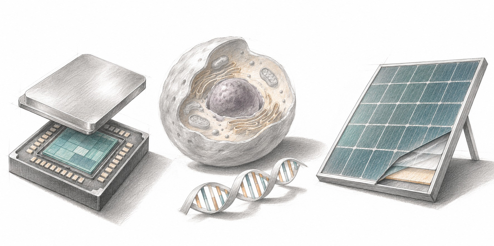

.. meta::
   :description: Chapter 2: Complete 40-technology plain-language atlas of China's Announcement No. 48 Attachment 1 across AI and silicon chips (23), biomedicine (5), and solar manufacturing (12).

=============================================
02. The Map of Forty Guarded Technologies
=============================================

How Governments Measure an Idea
===============================

How do you write a law that separates a student's weekend coding project from a strategic national asset? If you write "advanced AI and hardware are controlled," every calculator app and circuit board drowns in paperwork. If you name a specific company or model brand, tomorrow's rename slips straight past the gate.

Regulators solve this by drawing **numerical performance tripwires and purpose boundaries**. In Attachment 1 of Announcement 48, Beijing maps **40 distinct technology points** inside seven-character catalogue codes: **23 in artificial intelligence and AI hardware** (6 proposed prohibited, 17 proposed restricted), **5 in biomedicine** (3 prohibited, 2 restricted), and **12 in solar manufacturing** (5 prohibited, 7 restricted), matching the official totals of **14 prohibited** and **26 restricted** technologies `CN48 <https://www.mofcom.gov.cn/zwgk/zcfb/art/2026/art_0a31a3c9ac404f7a9b0e917ce3412997.html>`_ `CN-A1 <https://insanai.github.io/aiexportcontrols/sources/announcement-48-attachment-1.pdf>`_ `CNQA <https://www.mofcom.gov.cn/zwgk/zcjd/art/2026/art_b11d5c1e9374421e93e85dc87eba6e38.html>`_.

   Computing, biomedicine and solar manufacturing, shown through a processor, a cell and the layers of a solar panel.

Attachment 1 groups several numbered technologies under the same code. For example, 266504X has two main points, 266505X has four, 266506X has **two main points**, and 266507X has four. Our atlas splits the attachment into 40 reading checkpoints while retaining the original code and point. It is an editorial index, not a replacement legal list. `CN-A1 <https://insanai.github.io/aiexportcontrols/sources/announcement-48-attachment-1.pdf>`_

Reading the Tripwires Without Getting Tripped
=============================================

Keep three practical reading habits in mind as you explore the map:

1. **Spot "any one" versus "all together."** Entry ``266504X`` Point 2 (frontier large models) triggers if *any single one* of its three tests is met: :math:`\ge 10^{26}\text{ FLOPs}`, *or* :math:`\ge 2\text{ trillion parameters}`, *or* a live Global Top-10 benchmark rank. By contrast, ``266505X`` Point 1 (planning agents) triggers only if an agent splits tasks into :math:`\ge 20\text{ steps}` *and* hits :math:`\ge 80\%` decomposition accuracy *and* reaches :math:`\ge 90\%` subtask completion simultaneously `CN-A1 <https://insanai.github.io/aiexportcontrols/sources/announcement-48-attachment-1.pdf>`_.
2. **Purpose can be half the fence.** Several severe-looking entries (such as deepfake detection at :math:`\ge 95\%` accuracy in ``266401J``, or high-performance sensitive agents in ``266502J``) apply *only* when built specifically or mainly for national cross-border data defense, critical infrastructure, military, or core government settings. Ordinary studio tools and consumer assistants sit outside that purpose `CN-A1 <https://insanai.github.io/aiexportcontrols/sources/announcement-48-attachment-1.pdf>`_.
3. **Read the hardware inside the software list.** Notice that points 18 through 23 below (``266506X`` and ``266507X``) are not chatbots at all: they are **processor chip architectures, 3D NAND and DRAM memory designs, and >10,000-card supercluster interconnects**, while Footnote 4 pulls **the listed categories of physical solar machinery** into export control `CN-A1 <https://insanai.github.io/aiexportcontrols/sources/announcement-48-attachment-1.pdf>`_.

.. _atlas-explorer-start:

Artificial Intelligence, Chips & Superclusters (23 Checkpoints)
===============================================================

.. container:: atlas-card atlas-ai atlas-prohibited

   **266401J · Point 1: Cross-border security deepfake detection** *(Proposed Prohibited)*

   High-grade detection systems and equipment know-how built mainly to guard China's cross-border network-data security, achieving at least 95% accuracy and 95% recall across deepfake video, audio, images, or multimodal media. Ordinary consumer media checkers outside this national-security purpose are not the target.

.. container:: atlas-card atlas-ai atlas-prohibited

   **266402J · Point 1: Autonomous malware generation and mutation** *(Proposed Prohibited)*

   AI that autonomously writes or mutates malicious code capable of striking critical infrastructure, defense systems, or core government networks, hitting listed attack-success rates (at least 60% against multi-engine scanners, 85% against mainstream antivirus, or 90% against ML detectors). Everyday coding assistants are not covered.

.. container:: atlas-card atlas-ai atlas-prohibited

   **266402J · Point 2: Self-adapting cyber-evasion AI** *(Proposed Prohibited)*

   Offensive AI built for sensitive national-security targets that senses sandboxes, debuggers, or emulators to escape them, or automatically rewrites at least 50% of its code structure or control flow on every run while keeping its payload intact.

.. container:: atlas-card atlas-ai atlas-prohibited

   **266402J · Point 3: Mass automated evasion-variant swarms** *(Proposed Prohibited)*

   Technology for sensitive cyber operations that mass-produces and deploys evasive malware variants at scale: generating 20+ structurally distinct variants at once (or 80%+ end-to-end automation), 10+ daily variants with 30%+ syntax-tree divergence, or 90%+ behavioral consistency inside sandboxes.

.. container:: atlas-card atlas-ai atlas-prohibited

   **266501J · Point 1: Large models trained on China's Core Data** *(Proposed Prohibited)*

   Large AI models trained using China's legally designated *Core Data* (the highest national-security tier under the Data Security Law) and offered as services. What triggers this red line is the legal category of training data, never a company's brand name.

.. container:: atlas-card atlas-ai atlas-prohibited

   **266502J · Point 1: High-performance agents for critical or defense settings** *(Proposed Prohibited)*

   AI agents built specifically or mainly for critical infrastructure, national defense, or core government operations that also reach the high-capability benchmarks defined in ``266505X``. General-purpose productivity or coding agents do not fall here.

.. container:: atlas-card atlas-ai atlas-restricted

   **266402X · Point 8: Ultra-high-accuracy deepfake detection (98%+)** *(Proposed Restricted)*

   Deepfake detection systems and equipment-manufacturing know-how for video, audio, images, or multimodal content reaching both accuracy and recall of at least 98%, regardless of whether used for border-data defense.

.. container:: atlas-card atlas-ai atlas-restricted

   **266402X · Point 9: Near-invisible video and image steganography** *(Proposed Restricted)*

   Hiding and extracting secret data inside images or video only when all three benchmarks are met together: high survival under distortion (bit-error <=0.5% or recall >=99.9%), false-alarm rate <=0.1%, and near-total invisibility to human eyes (SSIM >=0.999, PSNR >=41 dB, or LPIPS <=0.005).

.. container:: atlas-card atlas-ai atlas-restricted

   **266404X · Point 6: AI-assisted zero-day and exploit discovery** *(Proposed Restricted)*

   Cybersecurity AI meeting any of six high bars: >=75% on top exploit benchmarks; building full exploit chains (>=50% on major OS/browsers or >=40% arbitrary code execution); 10x speed over senior human researchers; chaining 2+ low/medium bugs into working PoC attacks; finding 5+ critical or 50+ new bugs in a major OS or open-source project in one pass; or reaching the top tier of mainstream exploit scales.

.. container:: atlas-card atlas-ai atlas-restricted

   **266501X · Point 19: High-speed, anti-spoof or dialect voiceprint ID** *(Proposed Restricted)*

   Speaker-identification algorithms and systems hitting any one of four bars: >=99.1% true-match rate at <=0.01% false positives on short clips; <=300 ms latency at >=100 requests/sec; >=98% spoof detection (or <=1% false acceptance) against replay and synthetic voices; or >=90% accuracy tailored to Chinese minority languages or regional dialects.

.. container:: atlas-card atlas-ai atlas-restricted

   **266501X · Point 20: Chinese and minority-language machine translation** *(Proposed Restricted)*

   Translation technology built mainly for Chinese and China's ethnic-minority languages that achieves either a human quality score (MOS) of at least 4.8, or >=95% semantic fidelity paired with BLEU >=35 in general text (or BLEU >=30 in specialist domains).

.. container:: atlas-card atlas-ai atlas-restricted

   **266504X · Point 1: Large models trained on China's Important Data** *(Proposed Restricted)*

   Large models trained on legally defined *Important Data* and offered as services. Crucially, Note 1 carves out trace use (<=0.1%) when sanitized so the data neither boosts core domain R&D capability nor reappears in outputs, as well as data lawfully obtainable from public sources.

.. container:: atlas-card atlas-ai atlas-restricted

   **266504X · Point 2: Frontier large-model core technology** *(Proposed Restricted)*

   The heart of the AI model rule: covers weights, key checkpoints, underlying source code, architecture, training optimization, and inference acceleration if ANY ONE test is met: >=10^26 training FLOPs, >=2 trillion parameters, or a Global Top-10 public ranking at export time. Open-source releases qualify for Footnote 2 automatic-licensing facilitation.

.. container:: atlas-card atlas-ai atlas-restricted

   **266505X · Point 1: Long-horizon autonomous planning agents** *(Proposed Restricted)*

   Task-planning technology that breaks natural-language instructions into chains of 20 or more executable subtasks while hitting at least 80% decomposition accuracy and at least 90% average subtask completion. All three numbers must be met together.

.. container:: atlas-card atlas-ai atlas-restricted

   **266505X · Point 2: 60-agent collaborative orchestration** *(Proposed Restricted)*

   Multi-agent coordination frameworks running 60 or more concurrent AI agents at once, finishing work in no more than twice the fastest single-agent time for equivalent quality, and reaching >=85% agreement with ground-truth answers.

.. container:: atlas-card atlas-ai atlas-restricted

   **266505X · Point 3: 200-tool operating agents** *(Proposed Restricted)*

   Tool-use and system-operation technology supporting 200+ integrated third-party tools, picking the right tool at least 90% of the time, and succeeding at least 90% end-to-end on complex tasks that chain three or more distinct tools.

.. container:: atlas-card atlas-ai atlas-restricted

   **266505X · Point 4: Real-time strategic game and decision agents** *(Proposed Restricted)*

   Strategic AI meeting all three criteria at once: >=20 planning steps (or >=10 concurrent agents); adaptive sub-200 ms decisions across >=10 control units in dynamic environments; and outperforming 90% of human players on standard strategic benchmarks.

.. container:: atlas-card atlas-ai atlas-restricted

   **266506X · Point 1: AI processor architecture, instruction sets & IP cores** *(Proposed Restricted)*

   AI processor design technology covering custom architectures, instruction sets, compute IP cores, and base software stacks meeting any listed trait, including <=14 nm process need, floating-point or integer compute capability, 2.5D/3D chiplet packaging, high-speed interconnects, non-von-Neumann / compute-in-memory designs, or named vision/voice/driving uses. Footnote 2 offers automatic-licensing facilitation for overseas foundry tape-outs.

.. container:: atlas-card atlas-ai atlas-restricted

   **266506X · Point 2: Advanced 3D NAND flash and stacked DRAM / HBM chip design** *(Proposed Restricted)*

   3D NAND flash memory design hitting >=8 Gb/mm2 density, >=1.5 Gbps I/O speed, or wafer bonding; or DRAM memory design using <=18 nm lithography, vertical-channel transistors, bonding, or multi-layer HBM-style wafer/die stacking.

.. container:: atlas-card atlas-ai atlas-restricted

   **266507X · Point 1: Ultra-fast 10,000-GPU cluster interconnects** *(Proposed Restricted)*

   Chip-to-chip or node-to-node interconnect technology delivering bidirectional bandwidth of at least 800 GB/s inside giant AI compute clusters of more than 10,000 accelerator cards.

.. container:: atlas-card atlas-ai atlas-restricted

   **266507X · Point 2: Rapid fault recovery in 10,000-card training** *(Proposed Restricted)*

   Distributed-training resilience in >10,000-card clusters meeting any bar: checkpoint recovery (MTTR) <=120 seconds, seamless task migration with <=30 seconds of visible interruption, or <=5% effective GPU compute lost to network faults.

.. container:: atlas-card atlas-ai atlas-restricted

   **266507X · Point 3: Microsecond cluster communication scheduling** *(Proposed Restricted)*

   Communication scheduling for >10,000-card AI clusters achieving either >=98% linear scaling, dynamic topology-aware routing with <=1 microsecond end-to-end latency, or >=90% overlap hiding communication behind computation.

.. container:: atlas-card atlas-ai atlas-restricted

   **266507X · Point 4: Mixed-vendor and cross-region GPU orchestration** *(Proposed Restricted)*

   Software and ops know-how uniting AI chips from two or more different hardware vendors inside >10,000-card clusters, hitting listed high-bandwidth, throughput (+30%), card-utilization (+65%), cost-drop (-20%), 99.9% uptime, or >=80% cross-data-center training efficiency marks.

Biomedicine & Gene Platforms (5 Checkpoints)
============================================

.. container:: atlas-card atlas-bio atlas-prohibited

   **262704J · Point 1: Reusable cell and gene therapy (CGT) platforms** *(Proposed Prohibited)*

   Chinese-owned foundational platforms capable of generating multiple cell or gene therapies. Crucially, only selling ownership abroad is prohibited: out-licensing, CRO/CDMO contract manufacturing, and tech needed to develop, test, or market a specific individual medicine remain outside the ban.

.. container:: atlas-card atlas-bio atlas-prohibited

   **262705J · Point 1: Reusable siRNA drug-making platforms** *(Proposed Prohibited)*

   Chinese-owned foundational small-interfering RNA (siRNA) platforms, governed by the exact same boundary: transferring ownership of the reusable engine abroad is barred, while licensing deals, contract R&D/production, and single-drug partnerships stay open.

.. container:: atlas-card atlas-bio atlas-prohibited

   **267302J · Point 1: Pathogen enhancement and directed evolution** *(Proposed Prohibited)*

   Biosecurity red line covering artificial genetic modification or controlled serial-passage techniques that enhance pathogen function, sustain virulence at scale, or accelerate evolutionary adaptation. Routine medical diagnostics and vaccine care are unaffected.

.. container:: atlas-card atlas-bio atlas-restricted

   **262705X · Point 1: Discovery of unseen cell and gene therapy targets** *(Proposed Restricted)*

   Chinese-owned methods for finding and validating wholly new therapeutic targets never previously disclosed anywhere in the world via patents, journals, public databases, or conferences. Footnote 3 offers automatic-licensing facilitation for overseas licensing, joint R&D, and public-health emergencies.

.. container:: atlas-card atlas-bio atlas-restricted

   **262706X · Point 1: Discovery of unseen siRNA drug targets** *(Proposed Restricted)*

   Chinese-owned methods for screening and locking in wholly new, globally undisclosed siRNA drug targets, paired with the same Footnote 3 fast-track facilitation for international licensing, collaborative research, and humanitarian health responses.

Solar Silicon, Wafers & Factory Machinery (12 Checkpoints)
==========================================================

.. container:: atlas-card atlas-solar atlas-prohibited

   **263003J · Point 1: Mega-scale cold-hydrogenation polysilicon lines** *(Proposed Prohibited)*

   Cold-hydrogenation fluidized-bed recipes and equipment-making know-how capable of producing at least 250,000 tonnes of trichlorosilane per single line each year.

.. container:: atlas-card atlas-solar atlas-prohibited

   **263003J · Point 2: High-capacity silane fluidized-bed processes** *(Proposed Prohibited)*

   Silane fluidized-bed chemical recipes and equipment-making technology with single-line output of at least 20,000 tonnes per year.

.. container:: atlas-card atlas-solar atlas-prohibited

   **263004J · Point 1: Paper-thin 70-micrometer silicon wafers** *(Proposed Prohibited)*

   Know-how and machine-building technology for slicing solar silicon wafers 70 micrometers thick or thinner (roughly the width of a human hair), explicitly including control software, underlying algorithms, and engineering drawings.

.. container:: atlas-card atlas-solar atlas-prohibited

   **263801J · Point 1: Edge passivation for thin large-format cells** *(Proposed Prohibited)*

   Solar-dedicated edge-passivation processes and toolmaking know-how when used on 182 to 230 mm crystalline-silicon wafers that are 140 micrometers thick or thinner.

.. container:: atlas-card atlas-solar atlas-prohibited

   **263801J · Point 2: 30%-efficient perovskite and tandem solar tech** *(Proposed Prohibited)*

   Next-generation solar manufacturing across four benchmarks: >=30%-efficient mass-produced silicon-perovskite tandem cells (>=182 mm); >=1.1 m wide slot-die coating; >=18%-efficient single-junction perovskite modules (>=1 m2); or >=28%-efficient tandem modules (>=1 m2).

.. container:: atlas-card atlas-solar atlas-restricted

   **263004X · Point 1: 30,000-tonne polysilicon plant engineering** *(Proposed Restricted)*

   Complete plant-engineering packages, factory blueprints, and equipment designs for single-line polysilicon lines producing 30,000 tonnes or more per year.

.. container:: atlas-card atlas-solar atlas-restricted

   **263004X · Point 2: 800-tonne-per-furnace reduction processes** *(Proposed Restricted)*

   High-yield reduction furnace recipes and equipment-manufacturing technology turning out at least 800 tonnes of polysilicon per single furnace each year.

.. container:: atlas-card atlas-solar atlas-restricted

   **263005X · Point 1: Large-chamber monocrystalline silicon pullers** *(Proposed Restricted)*

   Solar ingot crystal-growing furnace designs hitting any listed mark: chamber inner diameter >=1,600 mm, thermal field >=35 inches, pull speed >=1.2 mm/min, or equal-diameter power draw <=40 kW.

.. container:: atlas-card atlas-solar atlas-restricted

   **263005X · Point 2: Long silicon-ingot cutting and grinding** *(Proposed Restricted)*

   Half-ingot cropping/grinding processes or precision machining and toolmaking know-how for solar silicon ingots 720 mm or longer.

.. container:: atlas-card atlas-solar atlas-restricted

   **263005X · Point 3: Rectangular or 130-micrometer thin-wafer slicing** *(Proposed Restricted)*

   Manufacturing know-how for rectangular solar wafers (>=182 mm on any side) or thin wafers (<=130 micrometers) using <=28-micrometer tungsten wire saws or high-speed spindles (>=6,500 rpm) and compact roller geometry.

.. container:: atlas-card atlas-solar atlas-restricted

   **263802X · Point 1: High-efficiency TOPCon and back-contact (XBC) cells** *(Proposed Restricted)*

   Six industrial process families (LPCVD/PECVD tunnel oxide, fast ALD passivation, boron diffusion, copper plating, microcrystalline deposition, and XBC plating) on 182 to 230 mm wafers <=140 micrometers thick for >=25%-efficient cells or >=22.3% modules.

.. container:: atlas-card atlas-solar atlas-restricted

   **263802X · Point 2: High-efficiency heterojunction (HJT) cell processes** *(Proposed Restricted)*

   Four HJT manufacturing families covering low-indium (<=50%) or ultra-fast TCO coating, crystalline-silicon film deposition on <=110-micrometer wafers, low-silver (<=30%) silver-coated copper pastes, and copper-plated HJT electrodes.

What This Means for the Two Teams
===================================

The atlas counts proposed technology points. The game scores express invented preferences; they do not count technologies. For the two teams, the useful question is which precise entry and conditions cover the next contribution, rather than whether all AI sits behind one wall.

The two teams' starting point is in :ref:`shared-workbench-story`.
