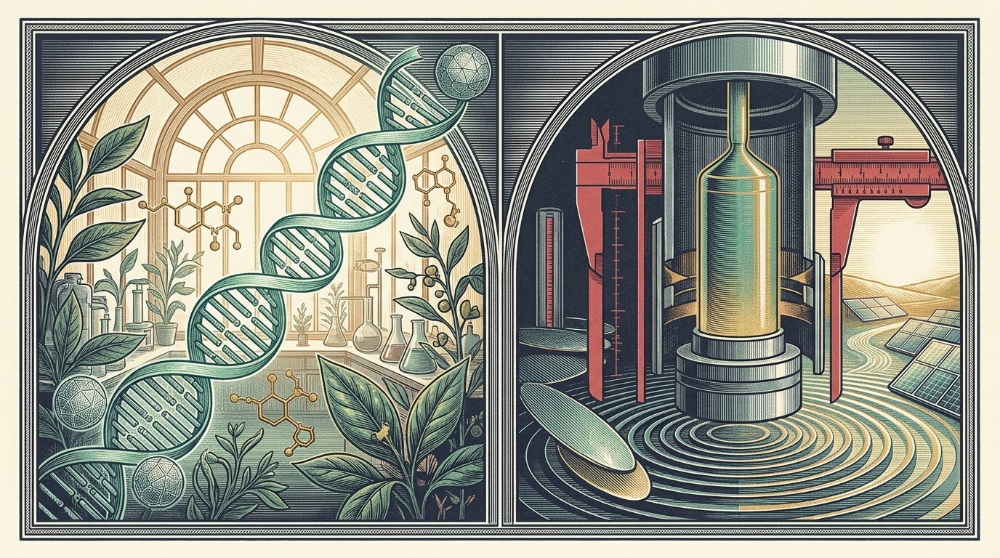

.. meta::
   :description: Chapter 5: Biomedicine in Announcement 48, guarding domestic ownership of reusable cell/gene therapy and siRNA platforms while keeping individual cures and global licensing open.

====================================================
05. Living Code: Gene Platforms and Shared Cures
====================================================

Guarding the Printing Press While Sharing the Books
===================================================

Artificial intelligence writes in floating-point numbers; modern biomedicine writes in the four-letter alphabet of life (``A, C, G, U/T``). Over the past decade, Chinese biotech teams have advanced from making off-patent generics to inventing reusable **cell and gene therapy (CGT)** engines and **small-interfering RNA (siRNA)** platforms that silence disease-causing genes before harmful proteins form.

   Knowledge inside living cells and industrial furnaces: on the left, reusable genetic platforms print individual medicines for patients worldwide; on the right, precision crystal-pulling furnaces carry manufacturing know-how inside physical hardware.

When doctors and patient advocates first saw "biomedicine" on Announcement 48's cover, many feared cross-border cancer trials or rare-disease partnerships might stall. Reading Attachment 1 closely reveals a surgical distinction: **Beijing guards domestic ownership of the reusable drug-making platform while leaving individual medicines free to travel the world** ``[CN-A1, 262704J and 262705J]`` ``[CNQA]``.

Picture a foundational CGT or siRNA platform as a custom **printing press** perfected over ten years (delivery vectors, chemical stabilization recipes, and modular design rules capable of printing twenty future therapies). Picture a specific clinical drug candidate as **one book** printed on that press:

* **Selling ownership of the printing press abroad is proposed prohibited (262704J & 262705J):** Chinese-owned original, reusable CGT and siRNA platforms cannot have their underlying **ownership** transferred to foreign buyers ``[CN-A1]``.
* **Out-licensing, contract manufacturing, and single-drug partnerships stay open:** Three explicit notes under both entries carve out overseas **out-licensing** (``对外授权许可``), **outsourced R&D and manufacturing (CRO/CDMO)** where ownership remains domestic, and all pipeline data needed for **preclinical research, clinical trials, manufacturing, quality control, regulatory approval, and commercialization of specific drug candidates** in global business-development deals ``[CN-A1]`` ``[CNQA]``. Only a sham "perpetual buyout license" that strips domestic ownership in substance crosses the red line.

Undisclosed Biological Targets and Biosecurity Walls
====================================================

Two **proposed restricted** entries (``262705X`` and ``262706X``) cover Chinese-owned technology for discovering and validating **wholly new therapeutic targets** in CGT and siRNA medicine, defined strictly as molecular targets **never previously disclosed anywhere in the world** in patents, journals, public databases, industry filings, or conferences ``[CN-A1]``. Even there, **Footnote 3** provides **automatic-licensing facilitation** for public-health emergencies, humanitarian relief, international collaborative research using overseas resources, and overseas out-licensing ``[CN-A1, note 3]`` ``[CNQA]``.

The fifth entry (``267302J``, proposed prohibited) is a pure **biosecurity wall** against artificial genetic modification and directed serial-passage methods that enhance pathogen virulence or accelerate controlled pathogen evolution ``[CN-A1, 267302J]``, paralleling Category 1 pathogen controls and ``EAR 744.4`` on the US side ``[EAR774]`` ``[EAR744]``. *(Bulk human genomic data, meanwhile, faces separate data-security rules in both countries, including the US Justice Department's Data Security Program ``[DOJ]``.)*
