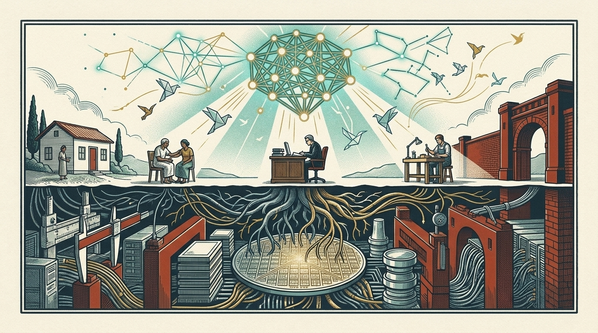

.. meta::
   :description: Impact of Export Controls on the Future of Open Source AI — how software, model weights, and silicon hardware gates reshape human progress, proven with primary sources and game theory.

=========================================================
Impact of Export Controls on the Future of Open Source AI
=========================================================

Imagine a world with no tollbooths on human thought. Two centuries ago, Thomas Jefferson marveled at a peculiarity of the human mind that no customs officer could quite grasp: *"He who receives an idea from me, receives instruction himself without lessening mine; as he who lights his taper at mine, receives light without darkening me."* Give away a loaf of bread and your table has one loaf fewer; give away an equation and two kitchens can bake tomorrow.

.. figure:: assets/images/cover-walled-commons.jpg
   :name: fig-cover-commons

   From an open commons to a guarded horizon: ideas once sailed freely across borders like folded paper birds, before export walls rose across both silicon hardware and frontier models — leaving one narrow jade doorway ajar for open-source science.

For four hundred years, humanity's greatest leaps rested on that quiet miracle. Movable type, germ theory, astronomical tables, the internet protocol suite, Linux, and most recently **open-source artificial intelligence** flourished because strangers across oceans could read, test, repair, and improve one another's work without waiting in line for a sovereign export stamp. Between 2023 and 2026, open-weight models turned what might have become a closed corporate priesthood into a living global commons. A rural clinic in Kenya triaging childhood pneumonia offline, a linguist rescuing an endangered mother tongue, and university students with two consumer graphics cards in Munich or Bengaluru suddenly held genuine frontier reasoning in their own hands ``[OSI]`` ``[R1]`` ``[QWEN]``.

Then the walls began to rise — not only in the sky of software, but deep underground in the bedrock of silicon.

Not Just Software or Weights: The Hardware Beneath Open Minds
=============================================================

Most conversations about open-source AI make a comforting mistake. They imagine an AI model as pure, weightless poetry — a file of code and numbers that can stay free forever as long as someone places an MIT or Apache 2.0 license on GitHub.

In physical reality, no neural network floats in thin air. Every open model sits atop an industrial pyramid of **extreme-ultraviolet lithography lenses, silicon wafers, stacked high-bandwidth memory (HBM), custom processor instruction sets, and miles of optical fiber stitching ten thousand accelerator cards into a single supercomputer**. Export controls have now clamped onto **both halves of that stack** at once:

   Mind and silicon are inseparable: open-source constellations illuminating clinics, classrooms, and workshops above ground draw their life from subterranean silicon wafers, stacked HBM memory, and ten-thousand-card supercluster cables now guarded by border gates.

* **Below the surface (Hardware & Silicon Chokepoints):** Washington built its border fortress around physical computation — restricting flagship AI chips (``3A090``), semiconductor manufacturing tools, and foreign-made chips designed with US software (``15 CFR 734.9``), even after calibrating conditional case-by-case review for H200-class exports in January 2026 ``[US26]`` ``[EAR734]`` ``[EAR742]`` ``[EAR774]``. Beijing's October 2026 draft answers in kind on the architectural side, proposing export controls on **AI processor designs, custom instruction sets, IP cores, 2.5D/3D chiplet packaging, non-von-Neumann chips, high-density 3D NAND, and <=18 nm or stacked DRAM designs** (``266506X``), alongside **10,000-card supercluster interconnects and multi-vendor chip-orchestration stacks** (``266507X``) and 18 classes of solar factory machinery ``[CN-A1]``.
* **Above the surface (Software, Weights & Data Gates):** On **16 October 2026**, China's Ministry of Commerce (MOFCOM) and Ministry of Science and Technology (MOST) issued **Announcement No. 48 of 2026**, proposing **40 technology checkpoints** across AI and chips (23), biomedicine (5), and solar manufacturing (12) while switching on mandatory pre-export registration that same afternoon ``[CN48]`` ``[CNQA]``. Private transfers of frontier model weights crossing :math:`10^{26}` FLOPs, **2 trillion parameters**, or a **Global Top-10 benchmark** (``266504X``) enter licensing gates, alongside Washington's own contested ``4E091`` closed-weight rule ``[CN-A1]`` ``[US25]`` ``[GAO26]``.

.. important::

   Even if software licenses remain free on paper, open-source AI cannot thrive in a vacuum: if export controls ration the chips needed to train open models, lock up open silicon blueprints, or price local hardware out of reach for hospitals and universities, humanity gets nudged back from owning minds to renting metered corporate cloud windows.

The Fortress Trap: What Game Theory Proves About Walled Intelligence
====================================================================

Every capital erects export walls in the name of safety and strategic advantage. Yet if we translate the rivalry between two technological powers — call them **Bloc A** and **Bloc B** — into crisp **mathematical game theory**, a chilling paradox appears: *unilateral walls look rational in a single move, yet mutual walls drag the entire world backward while making humanity measurably more dangerous.*

.. note::

   **Analytical model:** The mathematical payoff equations below model structural strategic incentives across open and closed innovation regimes; they are analytical proofs rather than statutory rules.

   Two fortresses across a dark strait: when rival powers hoard dim, solitary flames behind crimson battlements, storm shadows gather around both — whereas two flames joined in a shared lighthouse illuminate the entire sea.

Suppose each bloc chooses between sustaining an **Open Commons** (:math:`O`) for non-weaponized AI and compute architectures or erecting a **Broad Wall** (:math:`W`) across models and hardware. Each side begins with baseline domestic R&D value :math:`V = 10`. When a bloc stays **Open** (:math:`O`), its published breakthroughs, chip tools, and safety benchmarks create :math:`+8` of compounding spillover value for the other side. Building and enforcing a **Wall** (:math:`W`) imposes :math:`-1` in supply-chain duplication (re-inventing fabs, compilers, and siloed clusters), grants :math:`+5` in short-term strategic lead if the rival stays open (while inflicting :math:`-5` lag on the lone open side), and carries an expected systemic catastrophe cost :math:`R(s_A, s_B)`.

For each player :math:`i \in \{A, B\}`, net payoff is governed by one transparent equation:

.. math::

   \Pi_i(s_i, s_j) = 10 + 8\,\mathbb{I}(s_j = O) - \mathbb{I}(s_i = W) + 5\big[\mathbb{I}(s_i = W) - \mathbb{I}(s_j = W)\big] - R(s_i, s_j)

Why does systemic danger :math:`R` *rise* instead of fall when broad walls go up? Because software, hardware, cyber, and biological safety obey an **exponential law of independent scrutiny** (known in open-source engineering as Linus's Law). Suppose a frontier AI or chip stack harbors an unnoticed alignment flaw or critical zero-day vulnerability with base probability :math:`p_0`, and each independent research community catches it with probability :math:`q \in (0, 1)`. Across :math:`n` independent auditing communities, the probability that a catastrophic flaw survives undetected is:

.. math::

   P(\text{flaw survives}) = p_0 (1 - q)^n

* **Mutual Open Commons** :math:`(O, O)`: :math:`2k` global communities inspect weights, reproduce benchmarks, and equip hospitals, power grids, and universities with local defensive AI. Flaw survival drops exponentially to :math:`p_0(1 - q)^{2k}`, keeping systemic risk at :math:`R(O, O) = 1`. Each side earns :math:`10 + 8 - 0 + 0 - 1 = +17` (**World Welfare = 34**).
* **Unilateral Wall** :math:`(W, O)` **or** :math:`(O, W)`: Global scrutiny halves (:math:`R = 2`). The hoarder still reads the open bloc's papers and weights (:math:`+8`) while capturing a temporary monopoly lead (:math:`+5 - 1`), scoring :math:`+20`, while the lone open bloc drops to :math:`10 + 0 - 0 - 5 - 2 = +3` (**World Welfare = 23**).
* **Mutual Broad Walls** :math:`(W, W)`: Three dangers compound simultaneously: **(1)** closed silos shrink independent red-teaming eyes (:math:`m \ll 2k`), leaving hidden flaws unpatched; **(2)** civilian defenders (clinics, municipal utilities, small firms) lose open-weight defensive tools while covert attackers still operate in secret; and **(3)** strategic opacity between rival black-box labs breeds worst-case fear and rushed safety testing. Systemic danger quadruples to :math:`R(W, W) = 4`. Worse still, the zero-sum lead cancels out (:math:`+5 - 5 = 0`), leaving each side at :math:`10 + 0 - 1 + 0 - 4 = +5` (**World Welfare = 10**).

.. typst-diagram::
   :caption: The Prisoner's Dilemma of broad export walls (left) paired with Linus's Law of exponential flaw scrutiny (right), compiled natively with Typst and CeTZ.
   :name: fig-game-theory

   #import "figures/diagrams.typ": game-theory-matrix
   #game-theory-matrix(lang: "en")

Look at the cold logic of :numref:`fig-game-theory`:

1. **Walling is a strictly dominant one-shot temptation:** If Bloc B plays Open, Bloc A prefers Wall (:math:`20 > 17`). If Bloc B plays Wall, Bloc A still prefers Wall (:math:`5 > 3`). Left to uncoordinated fear, rational capitals march straight into the **unique pure-strategy Nash Equilibrium** :math:`(W, W) = (+5, +5)`.
2. **The world goes backward by 70 percent:** Global welfare collapses from **34** to **10**, and neither power ends up ahead of the other (:math:`5 = 5`). Trillions of dollars go into duplicating lithography tools, memory fabs, and closed training runs merely to stand still.
3. **The world grows four times more dangerous** (:math:`R = 4` vs. :math:`R = 1`): Secrecy feels safe inside a briefing room, yet mathematically it blinds global safety auditing and disarms civilian infrastructure.

How do intelligent societies escape a Prisoner's Dilemma? In game theory, the answer is **institutional mechanism design**: draw **high, narrow fences** around genuine weapons (core state secrets, autonomous cyber-weapons, engineered pathogens), while legally guaranteeing **open bridges** for shared science and open-source AI so neither side fears being trapped at :math:`+3`.

The Central Factual Discovery: An Ajar Doorway, Not a Sealed Wall
=================================================================

When we turn from game theory back to the verified legal texts of November 2026, we find something remarkable: despite alarming headlines, regulators in both Beijing and Washington have deliberately left real bridges standing for open-source AI:

.. typst-diagram::
   :caption: Attachment 1's 40 proposed checkpoints across AI and hardware (23), solar (12), and biomedicine (5), alongside the three footnote fast lanes preserving open-source and humanitarian science.
   :name: fig-forty-overview

   #import "figures/diagrams.typ": forty-checkpoints-chart
   #forty-checkpoints-chart(lang: "en")

* **Already-public open AI stays free.** Footnote 1 of China's draft explicitly excludes AI technologies that have already entered the public domain through open-source releases or published academic papers, mirroring the US published-information exemption in ``15 CFR 734.7`` and ``4E091``. Existing MIT and Apache 2.0 models are not pulled back behind a wall ``[CN-A1, note 1]`` ``[EAR734]`` ``[EAR774]`` ``[R1]`` ``[QWEN]``.
* **New open-source AI and chip tape-outs get a dedicated fast lane.** Rather than banning open releases of restricted AI, China's Footnote 2 proposes **automatic licensing and facilitation** ("apply and go" in MOFCOM's official explanation) for open-source exports, overseas foundry chip tape-outs (``芯片流片``), and Chinese firms' self-operated overseas compute clouds ``[CN-A1, note 2]`` ``[CNQA]``.
* **Yet the unguarded midnight upload is ending.** Pre-export registration on ``ecomp.mofcom.gov.cn`` already operates today for covered IP sales, overseas licenses, and foreign-control shifts; Core Data models (``266501J``) face outright prohibition; and hardware chokepoints continue to test who can build tomorrow's open minds ``[CN48]`` ``[CN-A1]`` ``[EAR742]``.

How to Read This Book
=====================

We wrote this book for normal, curious human beings — builders, researchers, doctors, founders, students, journalists, and citizens — who want vivid clarity backed by verified primary evidence:

* :doc:`announcement` and :doc:`atlas` unpack Beijing's Announcement 48, its two separate clocks, and all **40 guarded technologies**.
* :doc:`ai` takes you inside both the software recipe and the silicon hardware stack (``266504X``, ``266506X``, ``266507X``).
* :doc:`open-models` walks step-by-step, with visual flowcharts, through how open-source AI was released *before* export controls and how it navigates checkpoints *now*.
* :doc:`biomedicine` and :doc:`solar` explore living gene platforms and solar machines where know-how travels inside physical equipment.
* :doc:`united-states` demystifies Washington's chip (``3A090``) and model-weight (``4E091``) rules, including the May 2026 GAO clash ``[USNE]`` ``[GAO26]``.
* :doc:`comparison` sets both countries side by side with a complete directory of **government departments, portals, exact statutory timelines, and verified phone numbers, faxes, emails, and street addresses** for getting official approval.
* :doc:`questions` and :doc:`sources` close with six everyday scenarios, a plain-language glossary, and all **22 primary sources** verified as of **2 November 2026**.

.. note::

   **Note on official files:** MOFCOM published Attachments 1 and 2 in WPS format; we preserve the untouched original files in :doc:`sources` alongside local PDF reading copies. An unrelated organoid research presentation previously saved locally as ``china_export_control.pdf`` was excluded from our evidence.

.. toctree::
   :maxdepth: 2
   :hidden:

   announcement
   atlas
   ai
   open-models
   biomedicine
   solar
   united-states
   comparison
   questions
   sources
