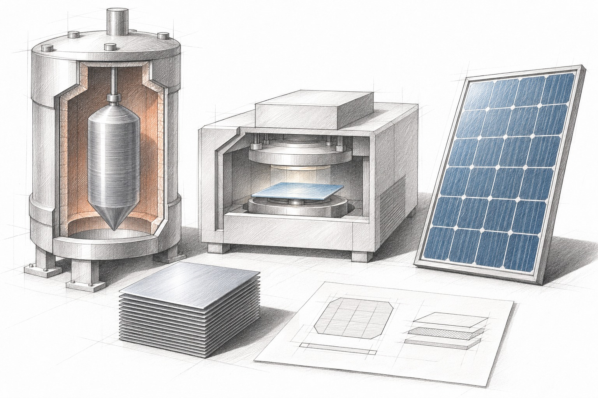

.. meta::
   :description: Chapter 6: Solar manufacturing controls in Announcement 48, covering ultra-pure polysilicon, 70-micrometer wafers, 30% perovskite tandems, and Footnote 4's listed equipment types.

=============================================
06. Capturing Sunlight Inside a Machine
=============================================

You Can Ship the Solar Panel, Not the Secret Kitchen
====================================================

The official explanation distinguishes manufacturing technology from products made with it. Announcement 48 does not create a blanket ban on finished solar panels. That statement concerns this announcement, not every customs rule or other measure that could affect a shipment. `CNQA <https://www.mofcom.gov.cn/zwgk/zcjd/art/2026/art_b11d5c1e9374421e93e85dc87eba6e38.html>`_

   A crystal-growing furnace, thin wafers and a coating machine show the equipment and knowledge behind a finished solar panel. The machinery is schematic.

Why, then, do **12 of the 40 technology points** (5 proposed prohibited, 7 proposed restricted) target solar manufacturing? Because China leads the world in turning raw quartz into ultra-pure polysilicon, pulling giant monocrystalline ingots, slicing wafers thinner than office paper, and coating next-generation tandem cells. As foreign governments offer subsidies and erect import tariffs to build domestic solar factories, Beijing is drawing a border around **both the industrial recipes and the physical factory machines that carry them** `CN-A1 <https://insanai.github.io/aiexportcontrols/sources/announcement-48-attachment-1.pdf>`_ `CNQA <https://www.mofcom.gov.cn/zwgk/zcjd/art/2026/art_b11d5c1e9374421e93e85dc87eba6e38.html>`_:

1. **Silicon purification (263003J & 263004X):** Proposed prohibitions cover mega-scale cold-hydrogenation fluidized beds (:math:`\ge 250{,}000\text{ tonnes/year}` trichlorosilane on a single line) and silane fluidized beds (:math:`\ge 20{,}000\text{ tonnes/year}`); restricted entries cover :math:`\ge 30{,}000\text{-tonne}` plant packages and :math:`\ge 800\text{-tonne-per-furnace}` reduction recipes `CN-A1 <https://insanai.github.io/aiexportcontrols/sources/announcement-48-attachment-1.pdf>`_.
2. **Ingot pulling and paper-thin wafers (263004J & 263005X):** Slicing silicon wafers :math:`\le 70\text{ micrometers}` thick (including control software, algorithms, and mechanical drawings) is **proposed prohibited** (``263004J``). Restricted entries cover giant crystal pullers (:math:`\ge 1{,}600\text{ mm}` chambers or :math:`\le 40\text{ kW}` power draw), machining :math:`\ge 720\text{ mm}` ingots, rectangular wafers (:math:`\ge 182\text{ mm}`), and :math:`\le 130\text{-micrometer}` slicing with :math:`\le 28\text{-micrometer}` tungsten wire saws `CN-A1 <https://insanai.github.io/aiexportcontrols/sources/announcement-48-attachment-1.pdf>`_.
3. **Tandem and high-efficiency cells (263801J & 263802X):** Proposed prohibitions guard mass-produced **perovskite and silicon-perovskite tandem** recipes (:math:`\ge 30\%` cell efficiency, :math:`\ge 1.1\text{-meter}` slot-die coaters, :math:`\ge 28\%` large tandem modules) and thin-wafer edge passivation. Restricted entries cover high-throughput **TOPCon, back-contact (XBC), and heterojunction (HJT)** processes (:math:`\ge 25\%` cell or :math:`\ge 22.3\%` module efficiency) `CN-A1 <https://insanai.github.io/aiexportcontrols/sources/announcement-48-attachment-1.pdf>`_.

Footnote 4: When the Physical Machine *Is* the Recipe
=====================================================

Just as AI software cannot be separated from AI chips, solar know-how cannot be separated from solar furnaces. When a supplier ships a deposition reactor, installs embedded control code, and trains foreign engineers for six months on the factory floor, the hardware carries the mind inside it.

**Draft Note 4** covers specified core photovoltaic equipment when it embodies listed technical indicators, including reactors, crystal furnaces, wafer saws and coating machines. Covered exports require temporary pre-export registration now. If adopted, the final catalogue would distinguish prohibited technology from restricted technology that needs permission. A license would not make a prohibited transfer permissible; the final text and procedures must be checked. `CN-A1, note 4 <https://insanai.github.io/aiexportcontrols/sources/announcement-48-attachment-1.pdf>`_ `CNQA <https://www.mofcom.gov.cn/zwgk/zcjd/art/2026/art_b11d5c1e9374421e93e85dc87eba6e38.html>`_ `CNMEAS <https://www.mofcom.gov.cn/dl/file/20211203230621.pdf>`_

What This Means for the Two Teams
===================================

A finished panel, a manufacturing machine and the knowledge used to operate it are different things. For a cooperating factory team, access to one does not supply all the others. The workbench question becomes which equipment and know-how can still move together under the applicable rules.

The two teams' starting point is in :ref:`shared-workbench-story`.
